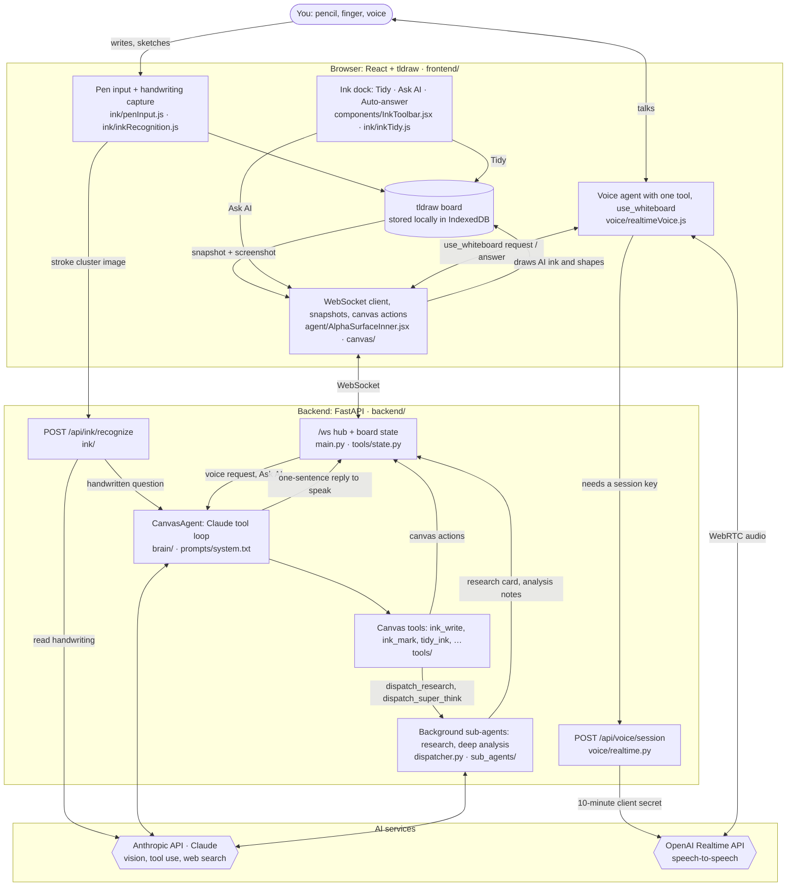

# AlphaSurface Whiteboard

**A handwriting-first AI whiteboard.** Write and sketch with an Apple Pencil, S Pen or your finger. The AI reads your ink, answers next to it in its own handwriting, and you can talk to it while you draw.

Forked from the open-source [AlphaSurface](https://github.com/adr1en360/AlphaSurface). This edition is rebuilt around pen input and runs on **Claude** (reasoning, handwriting, research) and the **OpenAI Realtime API** (live voice).

---

## Features

| Feature | What it does |
|---|---|
| **Pencil + finger input** | Opens ready to draw. Once a stylus is detected, *Pencil only* mode turns on (palm rejection): the pencil draws, **one finger pans**, two fingers pinch-zoom, a **two-finger tap undoes** and a three-finger tap redoes. Without a stylus, your finger draws. |
| **Reads your handwriting** | When you pause, nearby strokes are grouped and Claude recognizes text, math, shapes, arrows and drawings. Select some ink to see what it read ("Reads: …"). |
| **Answers in ink** | The AI circles, underlines, ticks, crosses out, stars or adds "?" to your work, draws arrows between ideas, and writes short handwritten replies. Its ink is violet and animates in like a pen. |
| **Auto-answer** | Write a question or unfinished problem (`12 × 8 =`, `why does this fail?`) and the answer appears next to it. Toggle with 💡. |
| **Ask AI** | Select anything and tap **?** to get a response next to it. |
| **Tidy** | Turns rough ink into clean typed text, neat shapes and connected arrows. One undo brings your strokes back. Also works by voice ("tidy this up"). |
| **Voice** | Talk while you draw, like a phone call: low-latency speech-to-speech with natural turn-taking. Talk over the AI to interrupt it. Replies also appear as captions. |
| **Research & deep analysis** | "Look up …" places a web-researched card on the board; "super think" places a deep analysis of the whole board. |
| **Installable app** | Add to Home Screen on iPad or Android, or install from desktop Chrome/Edge. Runs full screen; the board opens offline (AI needs the network). |

### Ink dock (right edge)

| Button | Action |
|---|---|
| ✎ / ✋ | Pencil only on (finger pans) / off (finger draws) |
| ✦ | Tidy the selected ink, or all ink on screen |
| ? | Ask AI about the selection, or about the screen |
| 💡 | Auto-answer handwritten questions on/off |

---

## How it works



**A voice request:** you ask out loud → the OpenAI Realtime voice calls `use_whiteboard` → the request goes over the WebSocket to the Claude CanvasAgent → Claude looks at the board, calls canvas tools (the browser draws the results) and returns one sentence → the voice says it.

**Handwriting:** when you pause, nearby strokes are sent as one image to `/api/ink/recognize` → Claude transcribes them → if it's a question or unfinished problem, the CanvasAgent writes the answer next to it in ink.

- **OpenAI Realtime** (`gpt-realtime-2.1`) is the voice: it hears you, talks back, handles interruptions and turn-taking. It can't see the board; for anything board-related it calls one tool, `use_whiteboard`, and says the answer it gets back.
- **Claude** (`claude-opus-5-5` by default) is the brain: it gets each request with a board screenshot and a summary of the shapes (including transcribed handwriting), acts on the board through canvas tools, and returns a one-sentence answer. It also reads handwriting, does research with web search, and runs deep analysis. Requests use the server-side refusal fallback, so if Claude declines a request on policy grounds, a fallback model answers instead of returning nothing.
- The browser never sees your OpenAI key. The backend creates a 10-minute key per session (`POST /api/voice/session` → OpenAI `POST /v1/realtime/client_secrets`), and the browser uses it to open the WebRTC call.
- Board requests take a few seconds while Claude works. The voice says a short "Let me look." first, so the gap isn't silent.

---

## Setup

### Prerequisites

- Python 3.12+ with [uv](https://docs.astral.sh/uv/)
- Node.js 18+
- An [Anthropic API key](https://console.anthropic.com) (required)
- An [OpenAI API key](https://platform.openai.com) with Realtime API access (optional; enables voice)

### 1. Backend

```bash
cd backend
uv sync
cat > .env <<'EOF'
ANTHROPIC_API_KEY=your_anthropic_key
OPENAI_API_KEY=your_openai_key      # optional: without it, voice is off
EOF
uv run uvicorn main:app --reload --port 8000
```

Check it: `curl localhost:8000/health` → `{"claude": true, "voice": true, …}`

### 2. Frontend

```bash
cd frontend
npm install
npm run dev
```

Open http://localhost:5173.

### Using it on a tablet

1. The Vite dev server listens on your LAN (`host: true`), so you can open `http://<your-computer-ip>:5173` on the tablet.
2. Browsers only allow the microphone over HTTPS (or on `localhost`). For voice on a tablet, put the frontend behind an HTTPS tunnel or deploy it. Ink features work over plain LAN HTTP.
3. In Safari or Chrome, choose **Share → Add to Home Screen**.

### tldraw license

tldraw runs unlicensed on `localhost`. **Any deployed URL needs a license key** from [tldraw.dev](https://tldraw.dev); without one, tldraw hides the board 5 seconds after load.

```env
# frontend/.env
VITE_TLDRAW_LICENSE_KEY=your_tldraw_license_key
```

---

## Configuration

All settings are environment variables in `backend/.env`.

| Variable | Default | Purpose |
|---|---|---|
| `ANTHROPIC_API_KEY` | none (required) | Claude |
| `OPENAI_API_KEY` | none | Voice (Realtime API); stays on the server |
| `ALPHASURFACE_CLAUDE_MODEL` | `claude-opus-5-5` | Model for the canvas agent, research and deep analysis |
| `ALPHASURFACE_AGENT_EFFORT` | `low` | Agent effort (`low`…`max`); low keeps spoken replies fast |
| `ALPHASURFACE_INK_MODEL` | same as above | Model for handwriting recognition |
| `ALPHASURFACE_INK_EFFORT` | `low` | Effort for handwriting recognition |
| `ALPHASURFACE_RESEARCH_EFFORT` | `medium` | Effort for web research |
| `ALPHASURFACE_SUPER_THINK_EFFORT` | `high` | Effort for deep analysis |
| `ALPHASURFACE_REALTIME_MODEL` | `gpt-realtime-2.1` | OpenAI Realtime voice model (`gpt-realtime-2.1-mini` is cheaper) |
| `ALPHASURFACE_REALTIME_VOICE` | `marin` | Voice (`marin`, `cedar`, `alloy`, …) |

**Cost and speed:** handwriting recognition makes one Claude call per pause in writing. To cut cost and latency, set `ALPHASURFACE_INK_MODEL=claude-haiku-5-5`. Compare its accuracy on your own handwriting first.

---

## Deploying

**Backend** (any container host, e.g. Google Cloud Run):

```bash
cd backend
gcloud run deploy alphasurface-backend --source . --region us-central1 \
  --allow-unauthenticated --port 8000 \
  --set-env-vars ANTHROPIC_API_KEY=...,OPENAI_API_KEY=...
```

**Frontend:** set `VITE_TLDRAW_LICENSE_KEY`, run `npm run build`, and serve `dist/` over HTTPS (the microphone needs it). The app calls the backend on its own origin at `/api/*` (HTTP) and `/ws` (WebSocket), so whatever serves `dist/` must forward both paths to the backend, including the WebSocket upgrade on `/ws`. A reverse proxy such as nginx or Caddy in front of both does this. The proxy in `frontend/vite.config.js` only applies to `npm run dev` and `npm run preview`, not to a static deploy. Some static hosts can rewrite `/api` but cannot forward WebSockets; on those, put the frontend behind a proxy that can.

Use HTTPS in production and keep API keys on the backend only.

---

## Project structure

```
backend/
├── main.py                 # FastAPI: WebSocket hub, wiring
├── model_config.py         # Models + provider settings (env-overridable)
├── brain/
│   ├── canvas_agent.py     # Claude tool loop: board → tools → spoken reply
│   ├── tool_schema.py      # Python functions → Claude tool definitions
│   └── claude.py           # Shared client, effort, refusal fallback
├── voice/realtime.py       # Mints short-lived Realtime keys for the browser
├── ink/
│   ├── recognizer.py       # Claude handwriting/sketch recognition
│   ├── geometry.py         # Hand-drawn marks and arrows for AI ink
│   └── api.py              # /api/ink/recognize, Ask AI, auto-answer
├── tools/                  # Canvas tools Claude can call
├── sub_agents/             # Research (web search) and deep analysis
├── prompts/system.txt      # The agent's instructions
└── tests/                  # pytest (no API keys needed)
frontend/
├── src/
│   ├── App.jsx, components/StartScreen.jsx
│   ├── agent/AlphaSurfaceInner.jsx   # WebSocket, snapshots, voice wiring, captions
│   ├── voice/realtimeVoice.js        # OpenAI Realtime agent + use_whiteboard tool
│   ├── ink/                          # Pen input, recognition, Tidy
│   ├── canvas/                       # Canvas actions + snapshot builder
│   └── components/InkToolbar.jsx     # Ink dock + caption chip
└── public/                           # PWA manifest, service worker, icons
```

---

## Development

```bash
cd backend && uv run pytest     # 46 tests, all offline (fake Claude/OpenAI clients)
cd frontend && npx eslint src   # lint
```

**Add a canvas tool:** write a function with type hints and a clear docstring in `backend/tools/`, then add it to `AGENT_TOOLS` in `tools/__init__.py`. Its schema is generated from the signature. If it emits a new action type, handle that type in `frontend/src/canvas/canvasActions.js` (and add it to `PAYLOAD_ACTIONS` there). Send shape ids with the `shape:` prefix (`tools.state.full_id`); Claude sees them without it.

---

## Known limitations

- Board requests by voice wait for Claude (typically 2–6 s at `low` effort); small talk is answered instantly by the voice model.
- If your app identifies individual users, OpenAI recommends sending a hashed user id as the `OpenAI-Safety-Identifier` header when creating the Realtime key (`backend/voice/realtime.py`). It isn't set by default.
- Box positions from handwriting recognition are approximate. Tidy places clean shapes close to, but not always exactly on, the original strokes.
- Single shared session: every connected browser sees the same board and the same AI.

---

## License & acknowledgements

MIT. Based on [AlphaSurface](https://github.com/adr1en360/AlphaSurface) and inspired by [Advait Sarkar](https://advait.org)'s research on AI as a thinking partner ([talk](https://youtu.be/3lPnN8omdPA)). Built on [tldraw](https://tldraw.dev).
